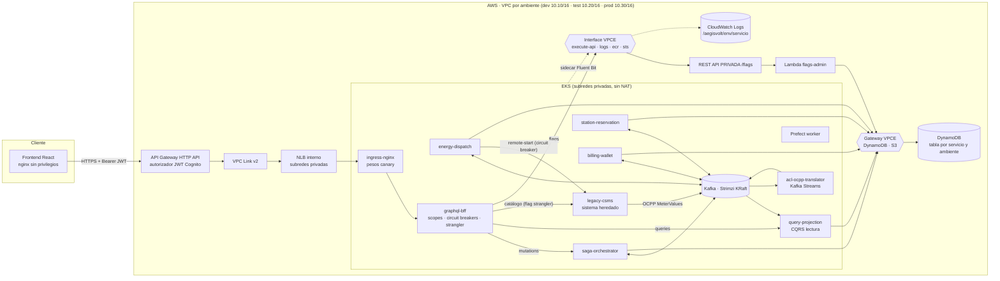
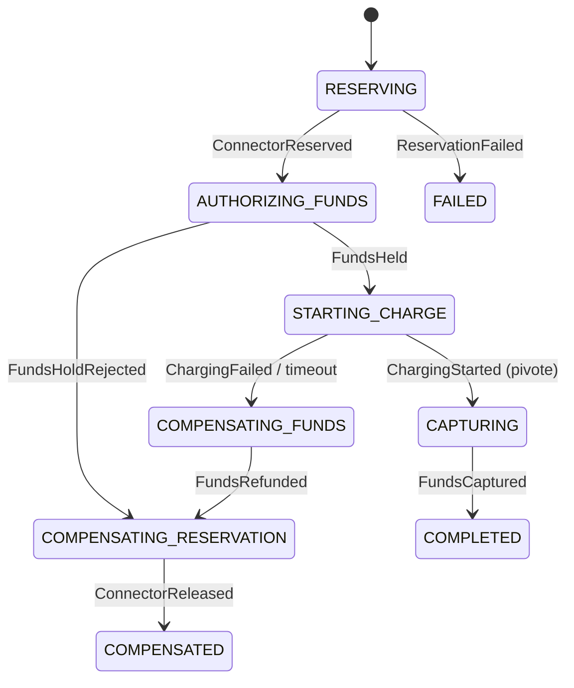

# 02 · Arquitectura de AegisVolt

## Vista general

## Bounded contexts (EDA)

| Contexto | Servicio | Tabla (Database-per-Service) | Publica | Consume |
|---|---|---|---|---|
| Reservas de estación | station-reservation | `aegisvolt-reservations-<env>` | respuestas SAGA, `station.ConnectorStatusChanged` | `reservation.*` comandos, `dispatch.Session*` |
| Billetera y facturación | billing-wallet | `aegisvolt-billing-<env>` | respuestas SAGA, `billing.WalletBalanceChanged` | `billing.*` comandos |
| Despacho de energía | energy-dispatch | `aegisvolt-dispatch-<env>` | respuestas SAGA, `dispatch.Session*` | `dispatch.*` comandos, telemetría |
| Coordinación (process manager) | saga-orchestrator | `aegisvolt-sagas-<env>` | comandos, `saga.SagaStateChanged` | `aegisvolt.saga.replies` |
| Lectura / reporting (CQRS) | query-projection | `aegisvolt-readmodel-<env>` | — | eventos de todos los contextos |
| Legado (externo) | legacy-csms + ACL | memoria propia | OCPP 1.6 | — |

Tópicos (clave de partición = `saga_id` → orden garantizado por SAGA):
`aegisvolt.{reservation,billing,dispatch}.commands`, `aegisvolt.saga.replies`,
`aegisvolt.{saga,station,billing,dispatch,telemetry}.events`, `legacy.ocpp.meter-values`, `aegisvolt.dead-letter`.

**Cómo se evita el monolito distribuido**

- Ningún servicio de dominio llama a otro por HTTP: solo comandos y eventos asíncronos.
- Ninguna tabla es compartida, e IAM lo hace cumplir (cada ServiceAccount tiene un rol con acceso
  solo a su tabla; además la política del Gateway VPCE solo permite tablas del propio ambiente).
- `aegis-common` contiene únicamente infraestructura (logs, sobre, outbox); los payloads los define y
  valida cada contexto.
- Sobre versionado y tolerante (`extra="ignore"`): un canary puede agregar campos sin romper a la
  versión estable.
- Imágenes, tags y despliegues independientes por servicio (tags por contenido).

## SAGA orquestada

**Por qué orquestación y no coreografía:** el flujo tiene un orden estricto y compensaciones en orden
inverso; con un orquestador ese flujo vive en un solo lugar (`services/saga-orchestrator/app/saga.py`,
una función pura `decide()`), es auditable (log de SAGA en DynamoDB) y demostrable. La coreografía se
usa donde no hay coordinación: `station-reservation` reacciona sola a `dispatch.SessionStarted/Ended`.

**Garantías**

| Problema | Solución |
|---|---|
| Doble procesamiento (Kafka es at-least-once) | `TransactWriteItems` con `Put MSG#<message_id>` condicionado: el duplicado cancela toda la transacción |
| Compensación repetida con otro `message_id` | Idempotencia de dominio: `ReleaseHold` sobre un hold `RELEASED` responde lo mismo sin mover dinero |
| Compensación que llega antes que la acción | Lápida `RELEASED_EMPTY`/`CANCELLED`: la acción tardía se rechaza |
| Publicar el evento y guardar el estado "a la vez" | Transactional Outbox: el mensaje se escribe en la misma transacción; un relay (sidecar) lo publica |
| Servicio que nunca responde | Timeouts en el log de SAGA (GSI `SAGA#ACTIVE` ordenado por deadline) + compensación |
| Efecto físico duplicado (remote-start) | Chequeo previo de `MSG#` + `Idempotency-Key` en el legado |
| Hardware caído | Circuit breaker: tras 3 fallos el circuito se abre y la SAGA compensa sin esperar timeouts |

## CQRS

- **Escritura:** comandos → orquestador → servicios (tablas propias, consistencia fuerte por agregado).
- **Lectura:** `query-projection` construye vistas desnormalizadas (`STATIONS`, `SAGA#…`, `FLEETS`)
  desde eventos. Las proyecciones son idempotentes y resistentes al desorden (solo aplican eventos más
  nuevos por `updated_at`/`version`).
- **Consistencia eventual visible:** tras `reserveAndCharge` la UI consulta `transaction(id)`; si la
  proyección aún no llegó, el BFF lee el log de SAGA (read-your-writes).

## Strangler Fig + ACL

1. `legacy-csms` es el sistema heredado: catálogo propio (`/api/v1/estaciones`, abreviaturas, kW como
   texto) y control de hardware OCPP 1.6.
2. El BFF decide con la flag `STRANGLER_ROUTE_STATIONS_TO_CORE` si el catálogo sale del core nuevo o del
   legado (traducido por la ACL síncrona `legacyAcl.js`). En prod la flag inicia apagada: la migración
   se hace ambiente por ambiente sin redesplegar.
3. La telemetría OCPP (`[2, id, "MeterValues", {...}]`) la traduce la ACL asíncrona en Kafka Streams
   (`acl-ocpp-translator`) a `telemetry.MeterValuesRecorded`; lo inválido va al dead-letter topic.

## Recorrido de un paquete

`Navegador → API Gateway (JWT) → VPC Link (ENIs en subredes privadas, SG vpclink) → NLB interno
(SG: solo desde vpclink) → target group tipo ip → pod ingress-nginx (SG de nodos: solo desde el SG del
NLB) → Service graphql-bff (NetworkPolicy: solo desde ingress-nginx) → Service query-projection.`

Para DynamoDB: el pod resuelve `dynamodb.us-east-1.amazonaws.com`; la **tabla de rutas privada**
tiene la ruta al *prefix list* de DynamoDB apuntando al **Gateway VPCE**, cuya política solo admite
tablas `aegisvolt-*-<env>`. No hay ruta `0.0.0.0/0` en subredes privadas (`nat_mode = "none"`).

Para las flags: el BFF llama a la URL privada de la REST API; el DNS privado del **Interface VPCE
`execute-api`** resuelve a ENIs dentro de la VPC (SG: 443 desde la VPC) y la *resource policy* de la
API niega cualquier llamada cuyo `aws:SourceVpce` no sea ese endpoint.

## Decisiones de arquitectura (resumen de ADRs)

| # | Decisión | Alternativa descartada | Motivo |
|---|---|---|---|
| 1 | SAGA orquestada | Coreografía pura | Orden estricto + compensaciones inversas + auditoría |
| 2 | Hold → Capture | Débito + reembolso | Coherente con "retención" (1.2) y con cobro real posterior |
| 3 | Outbox con GSI disperso + relay sidecar | DynamoDB Streams + Lambda | Funciona igual en Floci/local y en EKS; Streams queda como evolución |
| 4 | Flags en DynamoDB + Lambda | AppConfig / Unleash | Aislamiento físico por tabla, cero dependencias extra, demostrable en vivo |
| 5 | Argo Rollouts + ingress-nginx | Deployment con 2 réplicas | Peso exacto para HTTP y análisis automático con CloudWatch |
| 6 | Tags de imagen por contenido | Tag = SHA del commit | Las promociones por merge commit cambian el SHA; el contenido no |
| 7 | Polling en la UI | WebSocket/SSE | API Gateway HTTP no hace streaming |
| 8 | SPA con Vite | Next.js (RSC) | Sin superficie para React2Shell (CVE-2025-55182) |
